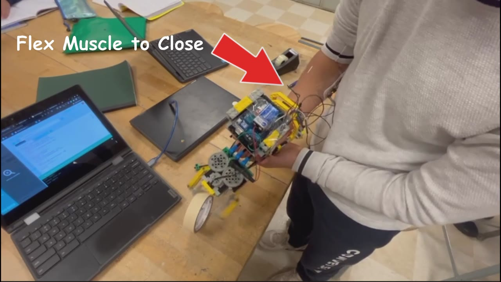
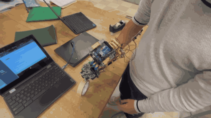
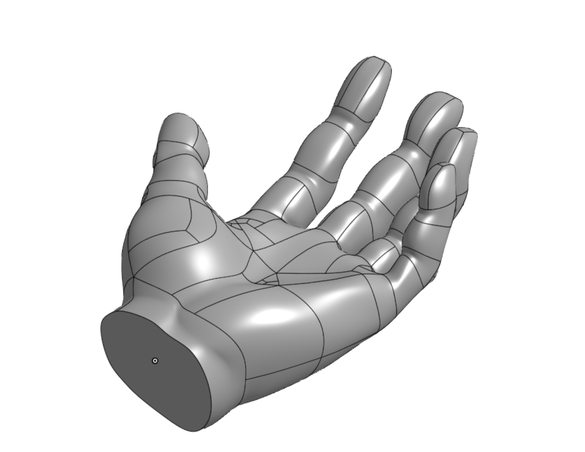

# Low-Cost Prosthetic Arm

A budget prosthetic hand that closes when you flex a muscle and opens when you relax it. An Arduino Uno reads a MyoWare EMG sensor and moves the fingers with servos. The threshold is calibrated for each user.

**Built:** Oct 2023 – Dec 2023 · **Stack:** Arduino Uno, MyoWare EMG, servos, LEGO, 3D printing, C/C++

## Demo

[Full video](docs/media/demo-v1.mp4) (15 seconds). This is the earlier version of the arm, before the 3D-printed fingers were added. Flexing closes the hand, relaxing opens it.

## Why LEGO

Prosthetics are expensive, so I wanted to see how cheap a working one could be. The frame is built from LEGO, which is inexpensive, easy to rebuild, and lets me change the mechanism in minutes instead of reprinting parts. The 3D-printed fingers were added on top of that frame.

## How it works

1. The MyoWare sensor sits on a muscle in the forearm and outputs an analog voltage.
2. The Uno reads it on A4, averages a few samples to smooth it, and converts to millivolts.
3. If the signal rises above the threshold, the servo closes the hand. When it drops back below, the hand opens.
4. A small hysteresis band keeps the hand from flickering when the signal sits near the threshold.

I chose **whole-hand control** (one muscle, open or closed) so the hand could grasp a wide range of objects instead of being designed around one grip.

### Per-user calibration

Everyone's muscle signal is different. When the Arduino powers up, it runs a quick calibration: relax for 3 seconds, then flex for 3 seconds. The threshold is set halfway between the resting level and the flex peak. If the flex isn't clearly stronger than rest, it asks again, which usually means the electrodes need repositioning.

## The fingers

The fingers are hollow 3D-printed PLA pieces, attached to the LEGO frame and moved by servos. Only the fingers were printed. The rest of the hand is LEGO.

*CAD model of the hand. Only the fingers were printed and used; the palm and frame are LEGO.*

I redesigned the fingers over multiple iterations.

## Problems I ran into

**Noisy EMG readings.** The signal was erratic at first. Moving the sensor to a muscle closer to the skin fixed it.

**Weak grip.** The servos couldn't close the fingers with enough force. I increased the servo power and the gear ratios.

**Finger design.** The fingers went through several redesigns before they worked with the mechanism.

## Feedback

I presented the prototype to a local prosthetics company for feedback.

## Parts

| Part | Notes |
|---|---|
| Arduino Uno | |
| MyoWare muscle sensor | |
| Servos | |
| LEGO | Frame and gear train |
| 3D-printed PLA fingers | Hollow |

## Wiring

| Pin | Connected to |
|---|---|
| A4 | MyoWare signal |
| D4 | Hand servo |

## About the code

- `src/prosthetic_arm/` is the full version: calibration on startup, smoothing, hysteresis, and whole-hand servo control.
- `src/early_prototype/` is the early version with a fixed threshold. I cleaned it up so it compiles.
- `archive/original_early_sketch.ino` is the unmodified sketch from the build. It doesn't compile as written, because it was adapted from a rover example and has leftover motor code and an undefined threshold variable.

The code from the final build was not recovered. I rebuilt the full version from the early sketch to match how the final hand behaved, so treat it as a reconstruction.

## Run it yourself

1. Open `src/prosthetic_arm/prosthetic_arm.ino` in the Arduino IDE.
2. Adjust `OPEN_ANGLE` and `CLOSED_ANGLE` for your finger mechanism.
3. Upload it, open the serial monitor at 9600 baud, and follow the calibration prompts.
